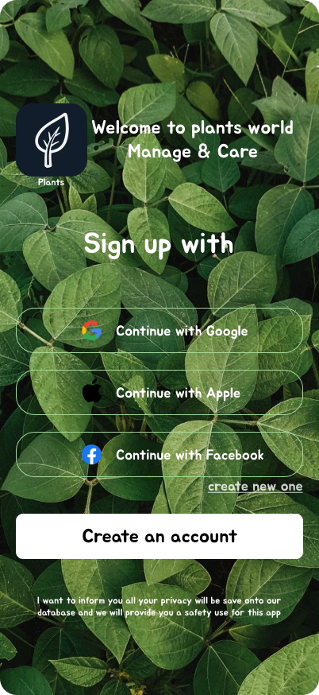
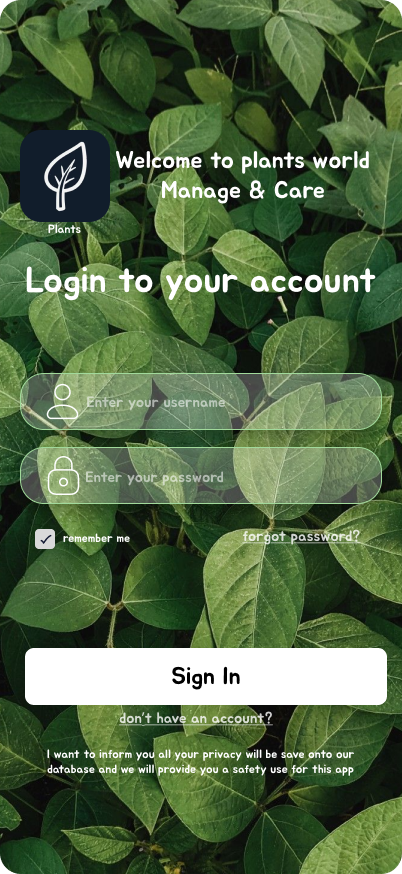
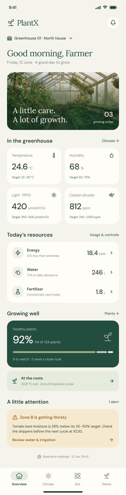
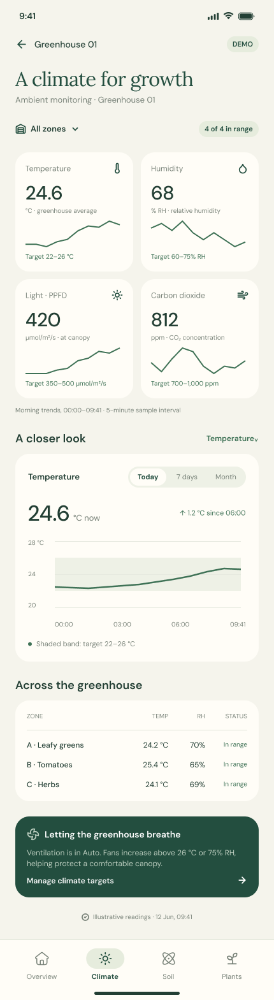
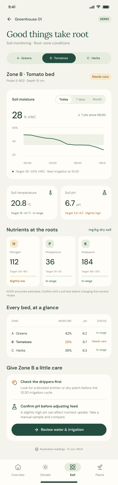
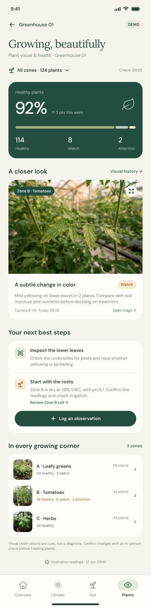
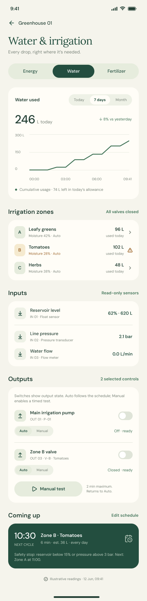
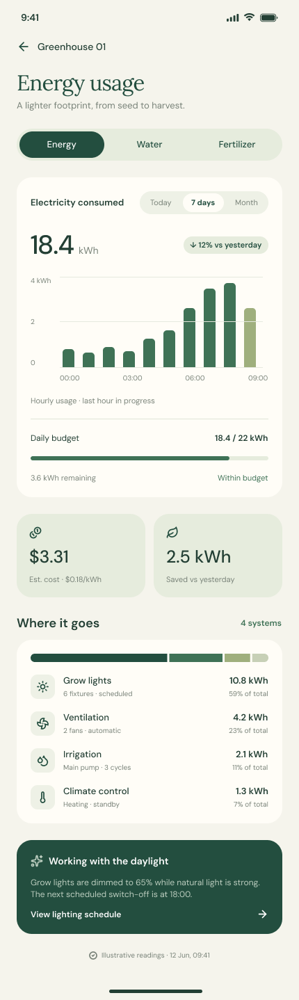
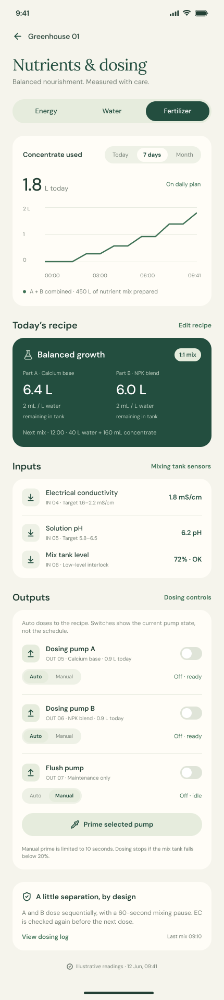
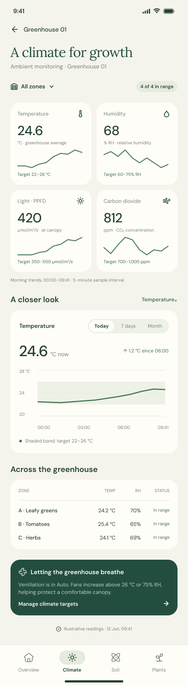

# demo1

A new Flutter project.

## Getting Started

This project is a starting point for a Flutter application.

A few resources to get you started if this is your first Flutter project:

- [Learn Flutter](https://docs.flutter.dev/get-started/learn-flutter)
- [Write your first Flutter app](https://docs.flutter.dev/get-started/codelab)
- [Flutter learning resources](https://docs.flutter.dev/reference/learning-resources)

For help getting started with Flutter development, view the
[online documentation](https://docs.flutter.dev/), which offers tutorials,
samples, guidance on mobile development, and a full API reference.

## 📱 Application UI Preview

### 1. Sign Up Screen & Login Screen

  

  

### 2. Overview Screen

### 3. Climate

  

### 4. Soil

  

### Plants

  

### Some more feature ui

  

  

  

  

